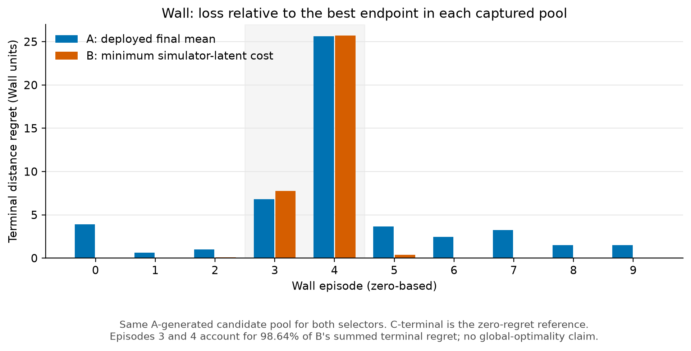
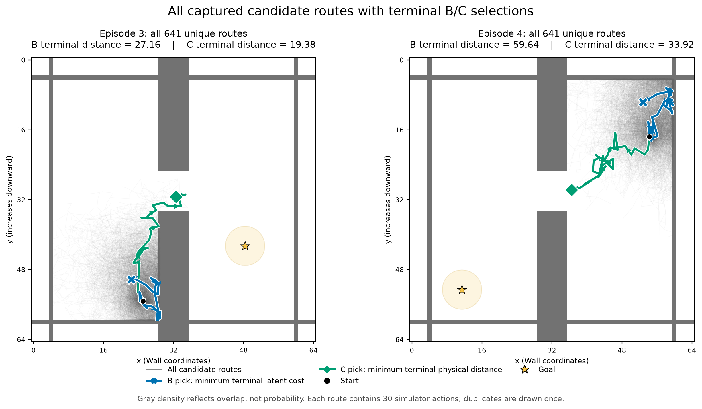
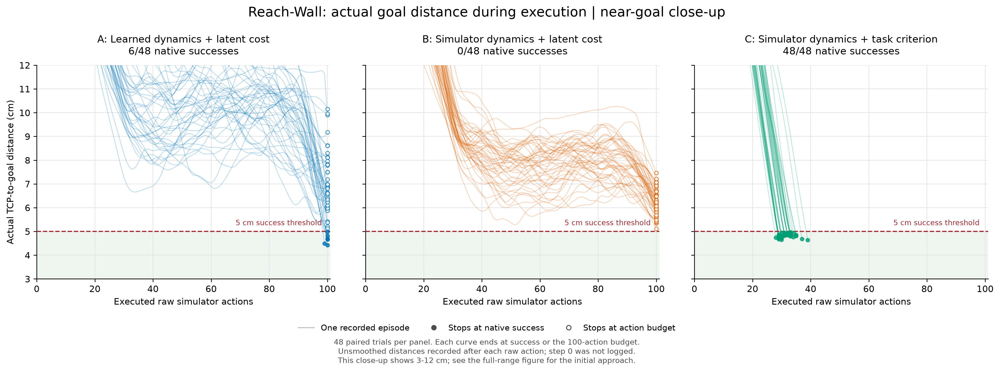
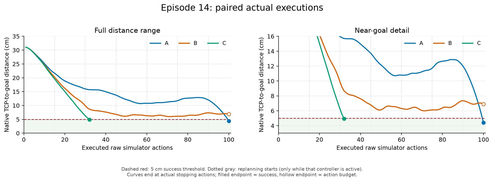
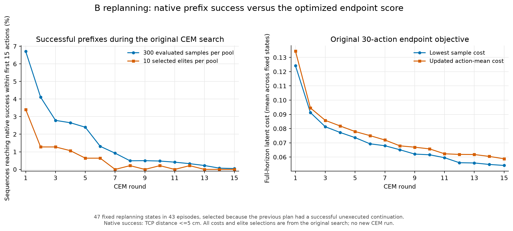

# World-Model Planning Diagnostics

**An independent empirical study by Joe Pei of prediction, latent goal scoring, search, and replanning in pretrained world-model planners.**

Why can a planner predict a promising future yet fail when it acts? I investigate this question using the released [JEPA-WMs](https://github.com/facebookresearch/jepa-wms) models on **Wall navigation** and **Meta-World Reach-Wall**. The study compares learned and simulator-based evaluation, first over identical candidate actions and then inside independently acting planners.

The main finding is a distinction between **evaluating available options** and **controlling a full episode**. On Reach-Wall, simulator-based latent evaluation selects better routes from a shared pool on average. That advantage does not translate into more successful episodes when the planner searches and replans independently. Subsequent audits find successful executable prefixes that the endpoint latent objective does not retain.

[Experimental protocol](docs/experiments.md) · [Reproduce the figures](docs/reproduction.md) · [Code map](docs/code-map.md) · [Published data](data/README.md) · [Research notes](notes/README.md)

## 1. Separating candidate generation from evaluation

At a saved simulator state, I evaluate the same action sequences in three ways:

| Branch | Future outcomes | Goal score |
| --- | --- | --- |
| **A** | Learned world-model predictions | Distance to the goal in latent space |
| **B** | Actual simulator outcomes, encoded with the same encoder | The same latent goal cost |
| **C** | Actual simulator outcomes | An explicitly defined native task criterion |

A/B use full-horizon endpoint scores. **C-terminal** uses physical goal distance at that same endpoint. The original **C-first-hit** criterion instead prioritizes reaching the goal, then earlier arrival. Both are retained and clearly separated below. A/B's latent objective combines visual-embedding MSE and 0.1 times proprioceptive-embedding MSE.

In the **shared-pool** experiments, every candidate comes from A's CEM search; B/C only rescore those actions. This controls the available options. A separate **closed-loop** experiment allows each planner to search for its own candidates, act, observe, and replan from its own subsequent states.

## 2. Wall: candidate coverage and endpoint regret

The Wall task requires navigating a dot through a doorway. I captured 10 CEM rounds with 64 evaluated sequences and one updated elite mean per round: **650 occurrences / 641 unique routes per episode**, across ten episodes. Each sequence contains 30 raw simulator actions.

Under the original first-hit criterion (goal distance **<4.5 Wall coordinate units**):

| Selection | Successful routes / 10 episodes |
| --- | ---: |
| A's deployed final elite mean | 5/10 |
| Minimum A cost in the captured pool | 5/10 |
| Minimum B cost in the captured pool | 7/10 |
| Best available first-hit C route | 7/10 |

No successful route exists in the captured pools for episodes **0, 3, and 4**. Perfect reranking of those pools cannot recover a successful option.

### A matched-terminal control

The original C criterion rewards first success, while B scores the final state. I therefore added continuous terminal Euclidean distance as a separate C criterion. Mean within-pool Spearman B/C agreement changes only from **0.6227 to 0.6236**. A/C-terminal agreement is **0.6549**, so B does not dominate A on every ranking measure. Mean terminal regret is **5.03** for A's deployed mean and **3.40** for minimum B, in Wall coordinate units.



*Terminal regret is the selected endpoint distance minus the smallest endpoint distance in the same recorded pool. It is conditional on available candidates, not regret against a globally optimal controller. Episodes 3 and 4 account for **98.64% of B's total terminal-distance regret**.*



*Gray traces show all 641 unique candidates per panel; blue highlights minimum B cost and green highlights minimum terminal physical distance. Neither pool contains an endpoint on the goal side of the wall, and neither contains a successful route. B also fails to choose the closest available endpoint. Coverage and ranking limitations coexist; this visualization does not identify their separate causal contributions. [All ten episode pools](figures/wall_all_candidate_routes.png).*

The Wall pilot used the original **unclipped Gaussian actions**, despite the environment's declared action box. It is not a bounded-action search benchmark. See [protocol details](docs/experiments.md#wall).

## 3. Reach-Wall shared pools: better evaluation, substantial remaining regret

Reach-Wall requires moving a robot's tool centre within **5 cm** of a target around an obstacle. The A run supplies **48 episodes × 7 planning calls = 336 decision pools**. CEM uses 15 rounds, 300 evaluated sequences, and ten elites. Including updated means gives **4,515 occurrences / 4,501 unique routes per decision**.

For the matched full-horizon **terminal** criterion:

| Selection | Terminal successes / 336 decisions | Mean terminal regret |
| --- | ---: | ---: |
| A's deployed final elite mean | 14/336 | 4.17 cm |
| Minimum A cost | 13/336 | 4.12 cm |
| Minimum B cost | **35/336** | **2.48 cm** |
| Minimum C-terminal distance | **243/336** | 0 cm |

B's endpoint is closer than A's deployed mean in **287 pools**, farther in 49. Average within-pool rank agreement with terminal C is **0.3768 for A** and **0.6154 for B**. These are decision-local route outcomes at **A's visited states**, not B/C episode success rates. Seven decisions within an episode are related observations.

Matching the temporal criterion barely changes aggregate agreement: original first-hit A/C and B/C correlations were 0.3751 and 0.6142. The remaining gap concerns alignment of the chosen latent metric, goal, and modality weighting with physical goal distance; it does not establish that the encoder lacks task information. [Tables and selections](data/reach_wall/shared_pool/terminal/).

## 4. Independent closed-loop planning: evaluation gains do not guarantee control gains

I then ran each planner independently from **48 paired initial states and goals**. The first sampled population is identical; subsequent CEM rounds, selected actions, and visited states can differ.

All branches have the same CEM proposal budget and bounded native actions in **[-1,1]^4**. They normally plan **30 raw actions**, execute **15**, then replan, with a **100-action episode budget**. The horizon shortens near the limit. Actual execution stops at the first native success.

Here **C uses first-hit task ordering**: all successes beat failures, earlier first hit wins among successes, and failures rank by terminal TCP distance. It is a privileged task-cost control, distinct from the terminal C shared-pool analysis above.

| Independent controller | Native episode successes | Mean final TCP distance |
| --- | ---: | ---: |
| A: learned dynamics + latent cost | **6/48** | 6.81 cm |
| B: simulator dynamics + latent cost | **0/48** | **6.20 cm** |
| C: simulator dynamics + first-hit task criterion | **48/48** | 4.82 cm |



*Each line is one actual execution. B finishes closer on average but stays outside the success region. A's endpoints are more variable across the different starts and include six successes. Curves are unsmoothed and end at the actual stopping action; successful runs are not padded to action 100. This near-goal view shows 3–12 cm. [Full distance range](figures/reach_wall_distance_all.png).*



*Episode 14 illustrates an A-success/B-failure case, not the average episode. At action 90 both controllers shorten to a ten-action plan that can be executed in full. Their states already differ. This observation does not isolate a horizon effect or establish that A is inherently more greedy.*

## 5. Inspecting the gap between a plan and its executed prefix

During the standard 30-action-horizon calls, selected B plans would reach success if completed in **47 planning calls across 43/48 episodes**. None succeeds within its first 15 actions. A has eight such full-plan successes across seven episodes, also with no successful first halves in these calls.

I examined the **47 successor replanning states** after B's successful continuations:

| Audit | Result |
| --- | ---: |
| Previously unexecuted remainder still succeeds from the new state | 47/47 states |
| New candidate pool contains a successful 15-action prefix | 44/47 pools |
| Any successful prefix among the final ten elites | 0/47 pools |
| Returned final mean has a successful prefix | 0/47 pools |

These are **other successful prefixes**, not exact resamplings of the old remainder. In 41 pools, an option both succeeds within 15 actions and ends inside the goal after 30, while the returned mean ends outside it.



*In this outcome-conditioned set of states, sampled-prefix success decreases from **6.71% in round 1 to 0.05% in round 15**, while the optimized endpoint latent score improves. This diagnoses objective/search/execution interaction under this protocol, rather than an intrinsic inability of CEM to solve Reach-Wall. [Audit tables](data/reach_wall/b_prefix_candidates/).*

A complementary comparison at the **48 matched initial states** removes later state-visitation differences: B's independently generated pool contains successful full routes in 4/48 starts versus A's 0/48. However, A has a closer pool-best route in 28 of the 44 starts where both pools fail. This supports a specific coverage advantage, not an overall search-quality ordering. [Matched-state comparison](docs/experiments.md#matched-initial-state-search).

## Scope

This is a completed diagnostic **pilot** using released pretrained checkpoints. It does not establish a new algorithm, global search optimality, a general ranking of planners, or the cause of every failure. Limits include ten Wall episodes, 48 Reach-Wall starts, one planning-seed protocol, one model family, and task-specific settings. Multiple search seeds at the same state and comparisons across model families remain future work. Euclidean failure distance is a proximity proxy, not obstacle-aware cost-to-go. C's native-state access is privileged and is not a practical learned-controller mitigation.

## Reproduce and inspect

The published data supports figure regeneration and aggregate checks **without a GPU, model downloads, or simulator execution**:

```bash
python -m pip install -r requirements-analysis.txt
python scripts/check_results.py
python scripts/plot_results.py
```

See [reproduction instructions](docs/reproduction.md) for the tested environment, native experiment commands, excluded large artifacts, and the distinction between reproducing published analyses and rerunning planning from scratch.

```text
data/       Captured Wall scores, native execution CSVs, derived tables, provenance
figures/    Figures used above
docs/       Protocol, reproduction, and code map
notes/      Original research-log drafts
scripts/    Data-only checks and figure regeneration
jepa-wms/   Attributed upstream snapshot with the study's code extensions
```

## Attribution

The pretrained models, training implementation, and base evaluation framework come from **[JEPA-WMs](https://github.com/facebookresearch/jepa-wms)** by Basile Terver, Tsung-Yen Yang, Jean Ponce, Adrien Bardes, and Yann LeCun, *What Drives Success in Physical Planning with Joint-Embedding Predictive World Models?* The vendored baseline is pinned to commit [`13cf1d9`](https://github.com/facebookresearch/jepa-wms/tree/13cf1d9c7e476f53c17714d2e0f1dc239a883ce0), with its original [README](jepa-wms/README.md), [license](LICENSE), and [third-party notices](THIRD-PARTY-LICENSES.md) retained.

This project's contribution is the diagnostic design, candidate-capture/replay extensions, independent oracle-evaluated CEM controllers, native-outcome audits, and analysis. [Code provenance](docs/code-map.md) identifies added and modified files. Research interpretations were developed and reviewed by Joe Pei; AI-assisted implementation and debugging were used during development.
